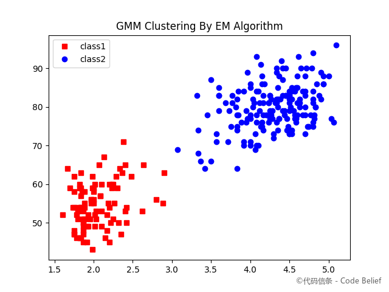
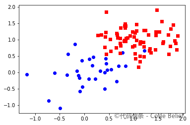
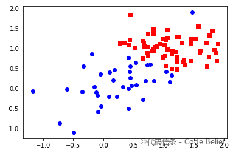
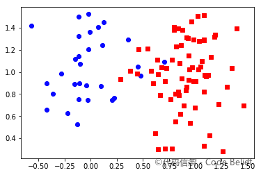
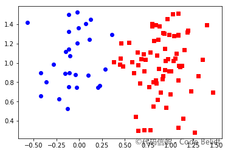

# gmm-em-clustering

高斯混合模型（GMM 聚类）的 EM 算法实现。

### 高斯混合模型简介

高斯混合模型（GMM, Gaussian Mixture Model）是多个高斯模型的线性叠加，高斯混合模型的概率分布可以表示如下：

$$P(x)=\sum_{k=1}^K \alpha_k \phi (x; \mu_k, \Sigma_k)$$

其中，K 表示模型的个数，&alpha;k 是第 k 个模型的系数，表示出现该模型的概率，&phi;(x; &mu;k, &Sigma;k) 是第 k 个高斯模型的概率分布。

这里讨论的是多个随机变量的情况，即多元高斯分布，因此高斯分布中的参数不再是方差 &sigma;k，而是协方差矩阵 &Sigma;k 。

我们的目标是给定一堆没有标签的样本和模型个数 K，以此求得混合模型的参数，然后就可以用这个模型来对样本进行聚类。

### GMM 的 EM 算法

EM 算法是通过不断迭代来求得最佳参数的。在执行该算法之前，需要先给出一个初始化的模型参数。

我们让每个模型的 &mu; 为随机值，&Sigma; 为单位矩阵，&alpha; 为 1&frasl;K，即每个模型初始时都是等概率出现的。

EM 算法可以分为 E 步和 M 步。

#### E 步

直观理解就是我们已经知道了样本 $x_i$，那么它是由哪个模型产生的呢？我们这里求的就是：样本 $x_i$ 来自于第 k 个模型的概率，我们把这个概率称为模型 k 对样本 $x_i$ 的"责任"，也叫"响应度"，记作 $\gamma_{ik}$，计算公式如下：

$$\gamma_{ik} = \frac {\alpha_k \phi(x_i; \mu_k, \Sigma_k)} {\sum_{k=1}^K \alpha_i \phi(x_i; \mu_k, \Sigma_k)}$$

#### M 步

根据样本和当前 $\gamma$ 矩阵重新估计参数，注意这里 x 为列向量：

$$\mu_k = \frac 1 N_k \sum_{i=1}^N \gamma_{ik}x_i$$

$$\Sigma_k = \frac 1 N_k \sum_{i=1}^N \gamma_{ik} (x_i - \mu_k)(x_i - \mu_k)^T$$

$$\alpha_k = \frac {N_k} N$$

### Python 实现

> 入口文件：[main.py](main.py)
>
> 算法文件：[gmm.py](gmm.py)

- 在对样本应用高斯混合模型的 EM 算法前，需要先进行数据预处理，即把所有样本值都缩放到 0 和 1 之间。
- 初始化模型参数时，要确保任意两个模型之间参数没有完全相同，否则迭代到最后，两个模型的参数也将完全相同，相当于一个模型。
- 模型的个数必须大于 1。当 K 等于 1 时相当于将样本聚成一类，没有任何意义。

### 测试数据

可直接使用 [sample.data](sample.data) 数据文件，或者通过 [genSample.py](genSample.py) 代码生成测试数据。

### 测试结果

样本 1 原始类别：

样本 1 聚类结果：

样本 2 原始类别：

样本 2 聚类结果：

### 参考资料

- **统计学习方法**，李航
- **Pattern Recognition and Machine Learning**，Christopher M Bishop

